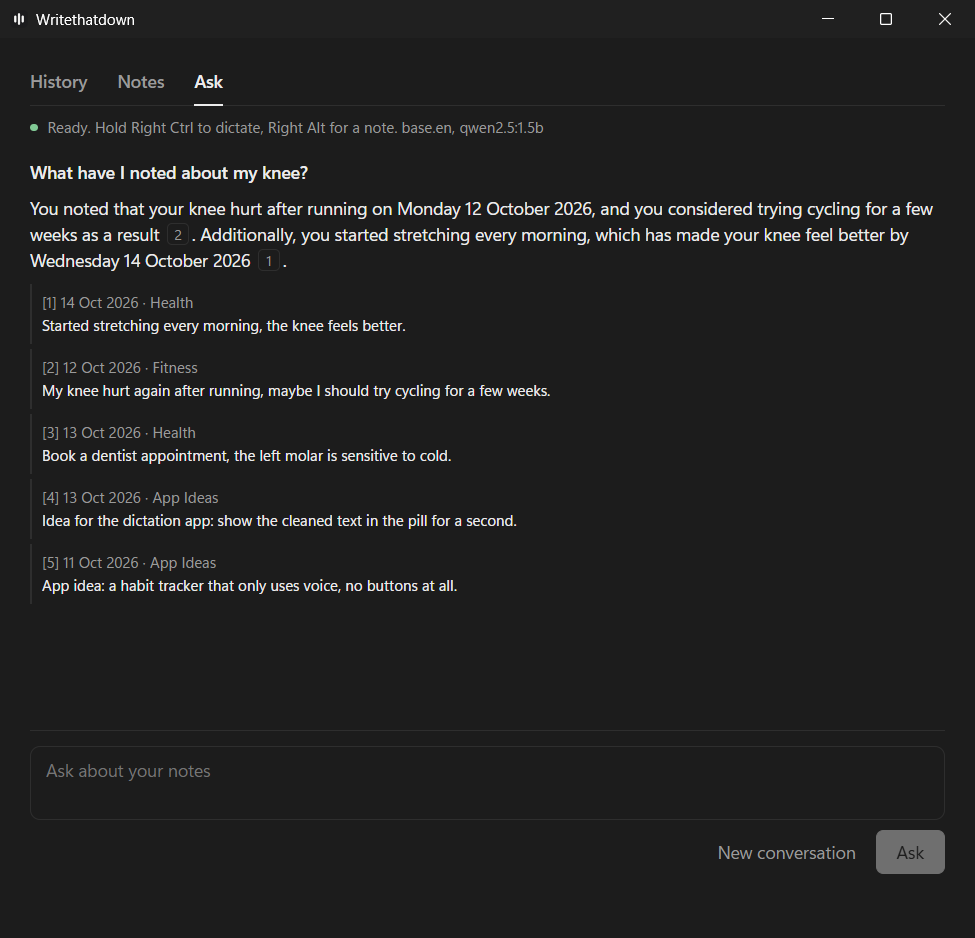
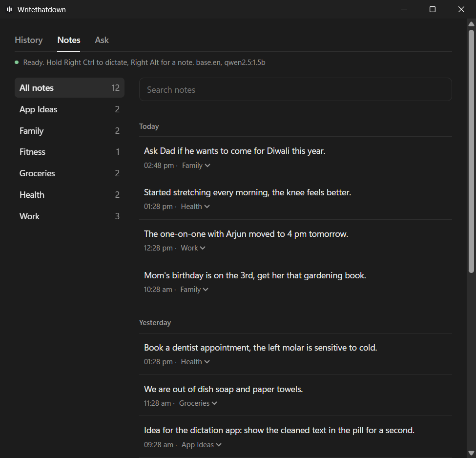
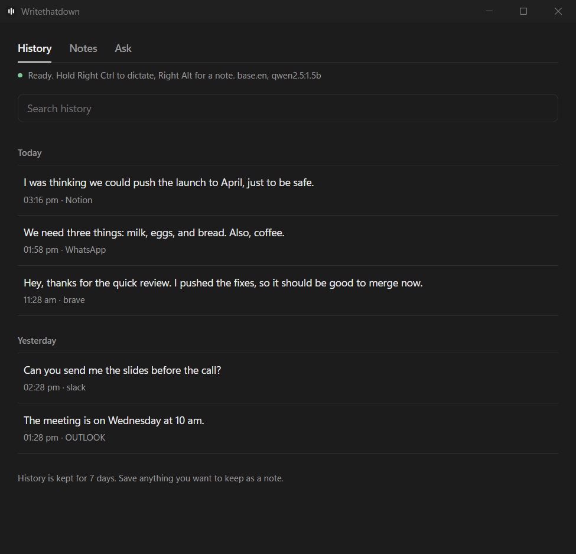

# Writethatdown

A fully local voice dictation app for Windows, in the spirit of Wispr Flow.
Speech recognition and every language model run on your own machine, on the CPU:
no cloud services, no API keys, nothing leaves your computer.

- **Dictate anywhere.** Hold **Right Ctrl**, speak, release: the text is transcribed
  with Whisper, cleaned up by a small local LLM (filler words, punctuation,
  "Tuesday, no wait, Wednesday" corrections), and pasted into whatever app has focus.
  Your clipboard is put back afterwards.
- **Hands-free.** Tap the key instead of holding it, talk as long as you like, tap again
  to stop. **Esc** cancels.
- **Voice notes.** Hold or tap **Right Alt** to dictate a note instead. Notes are filed
  into categories automatically, reusing existing ones when they fit. Say
  "file this under groceries" to choose one yourself.
- **Ask your notes.** Ask questions in plain language. Answers come only from your notes
  and cite the notes (with dates) they came from.
- **A quiet desktop app.** It lives in the tray, shows a small floating pill while you
  talk, and keeps a 7-day history of what you dictated. Notes are kept until you delete
  them.

Built with Rust ([whisper.cpp](https://github.com/ggml-org/whisper.cpp) via
`whisper-rs`), [Ollama](https://ollama.com), SQLite with
[sqlite-vec](https://github.com/asg017/sqlite-vec), and a Tauri 2 + React desktop app.

**Demo:** [watch a short walkthrough on Loom](https://www.loom.com/share/ecef5becb72f492db1598fcbedcbe12d)

## Screenshots

<p align="center">
  
</p>

**Ask** answers questions from your notes and cites them:



| Notes, filed into categories automatically | History of what you dictated |
|---|---|
|  |  |

<sub>Screenshots use made-up example data.</sub>

## Status

**Working**

- Tray app: runs in the tray with Start at login and Quit; closing the window keeps it
  running.
- Right Ctrl dictation: transcribed, cleaned up (fillers, self-corrections, numbers like
  "four thirty" → "4:30") and pasted into the focused app, with the clipboard restored.
- Hands-free: tap to start, tap to stop, Esc to cancel; Ctrl shortcuts don't trigger it.
- Right Alt notes: filed into categories automatically or with "file this under …";
  categories can be renamed and notes edited.
- Ask: answers questions from your notes and cites them.
- History: copy again, see the raw transcript, save as a note, delete.
- Fallback: if Ollama isn't running, the raw transcript is still pasted.

**In progress**

- Cleanup accuracy fixes from the eval (e.g. the LLM changing a meeting time): checks
  and a new prompt are in, being validated in daily use.
- A personal dictionary that learns from your corrections.

**Known limits**

- Windows only.
- English only.
- The first word can be cut off: the microphone only opens when the key is pressed.
- Long dictations are slow: for clips over 30 seconds, the total time to paste is
  about 12 s typically and up to about 28 s (p95), mostly cleanup on the CPU.
- The LLM judge for meaning drift isn't reliable yet; the deterministic drift check is
  the one to trust.

## Requirements

- Windows 10 or 11, 64-bit.
- 16 GB of RAM recommended. Dictation needs about 3 GB (the cleanup model unloads
  15 minutes after the last dictation). The 7B model used for filing notes and
  answering questions needs about 5 GB while loaded (it unloads 2 minutes after use).
- About 10 GB of disk for the models.
- No GPU needed. On a 12th-gen Intel laptop CPU, a 10-second dictation takes about
  1 second to transcribe and 2 seconds to clean up.

## Setup

### 1. Build tools

In PowerShell:

```powershell
winget install Git.Git
winget install Rustlang.Rustup
winget install Kitware.CMake
winget install LLVM.LLVM
winget install OpenJS.NodeJS.LTS
winget install Microsoft.VisualStudio.2022.BuildTools --override "--quiet --wait --add Microsoft.VisualStudio.Workload.VCTools --includeRecommended"
```

Close and reopen PowerShell so the new tools are on your PATH.

LLVM is needed to generate the whisper.cpp bindings. If you install it somewhere other
than `C:\Program Files\LLVM`, update `LIBCLANG_PATH` in `.cargo/config.toml`.

Then get the code, at a short path (the MSVC linker fails on paths longer than 260
characters):

```powershell
git clone https://github.com/Shelleyclam/Writethatdown.git C:\code\writethatdown
cd C:\code\writethatdown
```

### 2. Ollama and its models

```powershell
winget install Ollama.Ollama
```

Then, in a new PowerShell window:

```powershell
ollama pull qwen2.5:3b
ollama pull qwen2.5:7b
ollama pull nomic-embed-text
```

`qwen2.5:3b` cleans up dictation, `qwen2.5:7b` files notes and answers questions, and
`nomic-embed-text` makes notes searchable. To keep the models on another drive, set the
`OLLAMA_MODELS` environment variable before pulling them.

If Ollama isn't running, dictation still works and pastes the raw transcript.

### 3. Whisper models

From the project folder:

```powershell
powershell -ExecutionPolicy Bypass -File scripts\download-models.ps1
```

This downloads `base.en` (~148 MB) and `small.en` (~488 MB) into `models\`.

### 4. Build

```powershell
cargo build --release
cd app
npm install
npx tauri build --no-bundle
```

The first build compiles whisper.cpp and takes a few minutes.

## Using the app

Run `target\release\whisperflow-app.exe`. It sits in the tray.

- **Hold Right Ctrl** anywhere to dictate. The pill at the bottom of the screen shows
  Listening, then Transcribing, and disappears once the text is pasted.
- **Tap Right Ctrl** (a quick press on its own) for hands-free: it keeps recording until
  you tap it again. **Esc** cancels, and a forgotten recording stops after 10 minutes.
  Using Right Ctrl in a shortcut (like Ctrl+C) never starts a recording.
- **Hold or tap Right Alt** to dictate a note. The pill shows "Filing note", then where
  it was saved. While Writethatdown runs, Right Alt doesn't reach other apps, so it can't
  be used as AltGr.
- **History tab:** copy an entry again, see what Whisper heard before cleanup, save it as
  a note, or delete it. Entries older than 7 days are removed.
- **Notes tab:** browse by category, rename or merge categories, edit, recategorize or
  delete notes.
- **Ask tab:** ask about your notes and click a citation to open the note. The first
  question takes about 30 seconds while the model loads, then 10-15 seconds each.
- **Right-click the tray icon** for Start at login and Quit. Closing the window keeps the
  app running.

Everything is stored in `%APPDATA%\local.whisperflow\whisperflow.db`. Audio is never
saved. (Internally the project is still called `whisperflow`: the crates, the executables
and the data folder use that name.)

## Command-line tool

`target\release\whisperflow.exe` runs the same pipeline in a terminal. It's handy for
benchmarking and debugging.

```powershell
.\target\release\whisperflow.exe bench    # compare Whisper models on your voice
.\target\release\whisperflow.exe          # push-to-talk with Right Ctrl
```

| Option | What it does |
|---|---|
| `bench [clip.wav]` | Compare the downloaded Whisper models on one recording |
| `file <clip.wav>` | Transcribe (and clean up) a WAV file |
| `clean <text>` | Run the cleanup pass on typed text |
| `bench-cleanup [models]` | Compare cleanup models on built-in test sentences |
| `note <text>` / `ask <question>` | File a typed note / ask about your notes |
| `reindex` | Make notes saved while Ollama was off searchable |
| `record [name]` | Record eval clips into `eval\cases\` (see [eval/README.md](eval/README.md)) |
| `eval` | Score the pipeline on your recorded clips (see [Evaluation](#evaluation)) |
| `--model <name>` | `base.en` or `small.en` (default: `base.en`) |
| `--threads <n>` | CPU threads for Whisper (default: up to 8) |
| `--llm <name>` | Ollama model for cleanup (default: `qwen2.5:3b`) |
| `--no-cleanup` | Use the raw Whisper transcript |
| `--notes` | Also use Right Alt for notes (saved in the app's database) |
| `--no-paste` | Only print the text, don't paste it |
| `--save-wav` | Keep each recording in `recordings\` for debugging |

Set `WHISPERFLOW_DB` to use a different database, for example a scratch one for testing.
Don't run the app and the command-line push-to-talk at the same time: both would paste.

## Evaluation

`whisperflow eval` runs recorded dictations through the same pipeline the app uses and
measures:

- **WER** (word error rate): raw, for what Whisper heard against what was said, and
  final, for what would be pasted against what was wanted.
- **Meaning drift**: cases where cleanup added or dropped meaningful words, checked
  deterministically, with an optional second opinion from a local LLM judge.
- **Latency**: p50 and p95 for transcription, cleanup and the total, on the CPU.

Results are broken down by tags such as names, numbers, self-corrections and length.
How to record clips, fill in the sheet and run it is in [eval/README.md](eval/README.md).
Recordings, transcripts and results stay on your machine and are not in this repo.

### Results

33 of my own dictations (10.4 minutes), Whisper `base.en` on an i5-12500H CPU. Raw
Whisper WER is 14.7%. Final WER compares what would be pasted with the text I wanted,
so it includes Whisper's mistakes as well as cleanup's.

| | Whisper only | Cleanup before fixes | Cleanup now |
|---|---|---|---|
| Final WER, all | 39.8% | 39.0% | **35.0%** |
| Short dictations (< 10 s, 16 clips) | 18.2% | 26.3% | **13.9%** |
| Medium (10–30 s, 11 clips) | 50.2% | 41.4% | 43.9% |
| Long (> 30 s, 6 clips) | 40.5% | 40.8% | **36.2%** |
| Meaning drift flagged | – | 6 of 33 | 5 of 33 |
| Total latency p50 / p95 | 1.7 / 6.3 s | 2.2 / 15.8 s | 3.9 / 28.2 s |

"Before fixes" is the 21 October baseline (qwen2.5:1.5b, original prompt). "Whisper
only" and "now" (qwen2.5:3b) are from the same run on 3 November. That run's
transcription was also slower than on 21 October (p50 1.7 s vs 1.3 s), so part of the
latency gap is the machine, not the pipeline.

What the eval caught, and what changed:

- **Cleanup changed a meeting time** (4:30 → 5:30). Cleanups that contain a number that
  wasn't said are now rejected and the raw transcript is pasted.
- **Cleanup dropped a whole idea** from a long dictation. A run of 4 or more missing
  content words now counts as a failed cleanup.
- **Cleanup added a summary sentence nobody said.** Output more than 3 words longer than
  the input is rejected.
- **The larger model turned a negative statement positive.** Adding or dropping a
  negation is rejected (dropping one is allowed after "no wait"-style corrections).
- **Cleanup over-trimmed short casual messages**: they came out worse than raw Whisper
  (26.3% vs 18.2%). A prompt built on my own style rules and examples, plus the larger
  model, brought them to 13.9%.

**What this means:** I mostly dictate long notes to jot down detailed ideas, so long
dictations matter most to me. Cleanup now improves them (40.8% → 36.2%) and no longer
changed facts in my 33 recordings. A wrong fact is worse than a wrong word, so when a
check fails, the app
pastes the raw transcript instead. The cost is speed: a long note can take about 28 s at
p95, which is too long to wait. Next I'd transcribe in chunks while I'm still speaking,
so most of the work is done by the time I stop. Medium dictations got slightly worse;
that's next after latency.

## Decisions and trade-offs

- **Fully local, on the CPU.** No API keys, no cloud, and it works offline: what you
  dictate never leaves the machine. The cost is smaller models and slower long
  dictations than a cloud service.
- **Whisper `base.en` over `small.en`.** On real dictation `base.en` transcribed at
  about 0.10× real time vs 0.36× for `small.en`, with near-identical accuracy.
  `small.en` is still one flag away (`--model small.en`).
- **qwen2.5:3b over 1.5b for cleanup.** Final WER 35.0% vs 37.8% and short dictations
  13.9% vs 20.4%, for about 0.4 s more on a short dictation, 3–4 s more on long ones,
  and 2.3 GB of RAM instead of 1.1 GB. It unloads after 15 idle minutes to give the
  memory back.
- **The LLM never gets the last word.** Every cleanup is checked for unsaid numbers,
  flipped negations, added text and dropped ideas. If a check fails, or Ollama is down,
  the raw transcript is pasted: a visible typo is better than a silently changed
  meaning.
- **Speed where it's felt, quality where it isn't.** Dictation uses the small model
  because you're waiting on it. Filing notes and answering questions use qwen2.5:7b,
  because the 3B model filed notes into the wrong categories and a few extra seconds
  matter less there.

## Troubleshooting

- **"only silence, ignored"**: Windows is using the wrong microphone. Pick the right one
  under Settings → System → Sound → Input, then restart Writethatdown.
- **Nothing is pasted into one particular app**: Windows blocks simulated keystrokes into
  apps running as administrator. Run Writethatdown as administrator too.
- **The first word gets cut off**: start speaking a beat after pressing the key. The
  microphone takes a moment to open.
- **Notes or questions fail with out-of-memory errors**: the 7B model needs about 5 GB of
  free memory. Close some browser tabs, or give Windows a larger page file.
- **Build fails mentioning cmake or a C++ compiler**: reopen PowerShell after installing
  the build tools, or build from "Developer PowerShell for VS 2022".

## Project layout

```
src/audio.rs       microphone capture, conversion to 16 kHz mono
src/hotkey.rs      Right Ctrl / Right Alt keys (Windows low-level keyboard hook)
src/engine.rs      the dictation loop: record, transcribe, clean up, paste or file, save
src/transcribe.rs  Whisper model loading and transcription
src/pipeline.rs    transcribe + clean up, shared by dictation and the eval
src/cleanup.rs     LLM cleanup pass, with checks that fall back to the raw text
src/numbers.rs     matching spoken and written numbers ("four thirty" = "4:30")
src/paste.rs       paste into the focused app, saving and restoring the clipboard
src/storage.rs     SQLite: history, notes, categories, embedding vectors
src/notes.rs       filing notes: "file this under", categories, chunking, search index
src/ask.rs         answering questions from notes, with citations
src/ollama.rs      small client for the local Ollama server
src/main.rs        command-line tool
src/eval/          eval suite: WER, meaning drift, latency, reports
app/src-tauri/     desktop app backend: tray, pill window, commands
app/src/           desktop app UI (React)
eval/              how to record and run evals, and the empty cases sheet
scripts/           Whisper model downloader
```

## How it was built

The project grew in six steps:

1. Hold to record, transcribe locally, benchmark the Whisper models
2. Paste into whatever app is focused
3. Clean-up pass with a local LLM
4. Desktop app: floating pill, tray icon, history window
5. Notes key, automatic categories, and Q&A over notes
6. Hands-free mode: tap to start, tap to stop

`CLAUDE.md` has the design decisions and build notes behind each step.

## License

[MIT](LICENSE)
